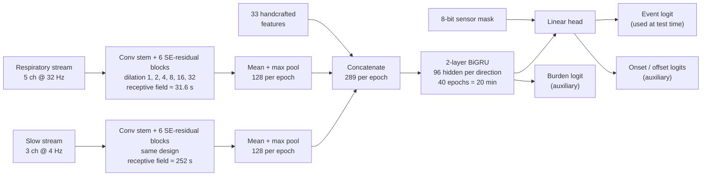
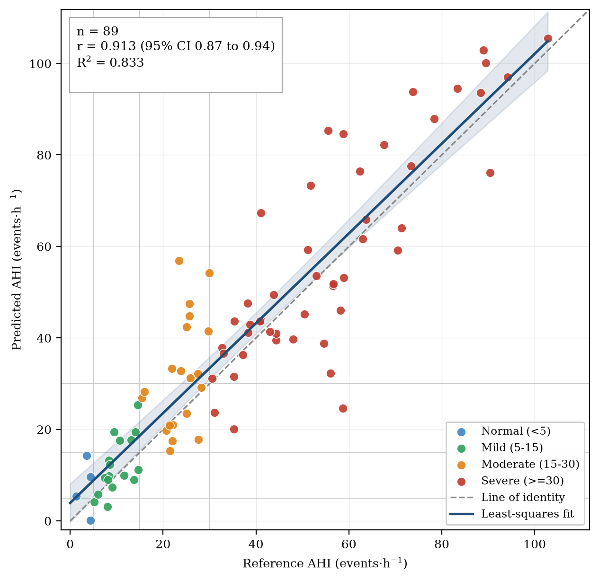
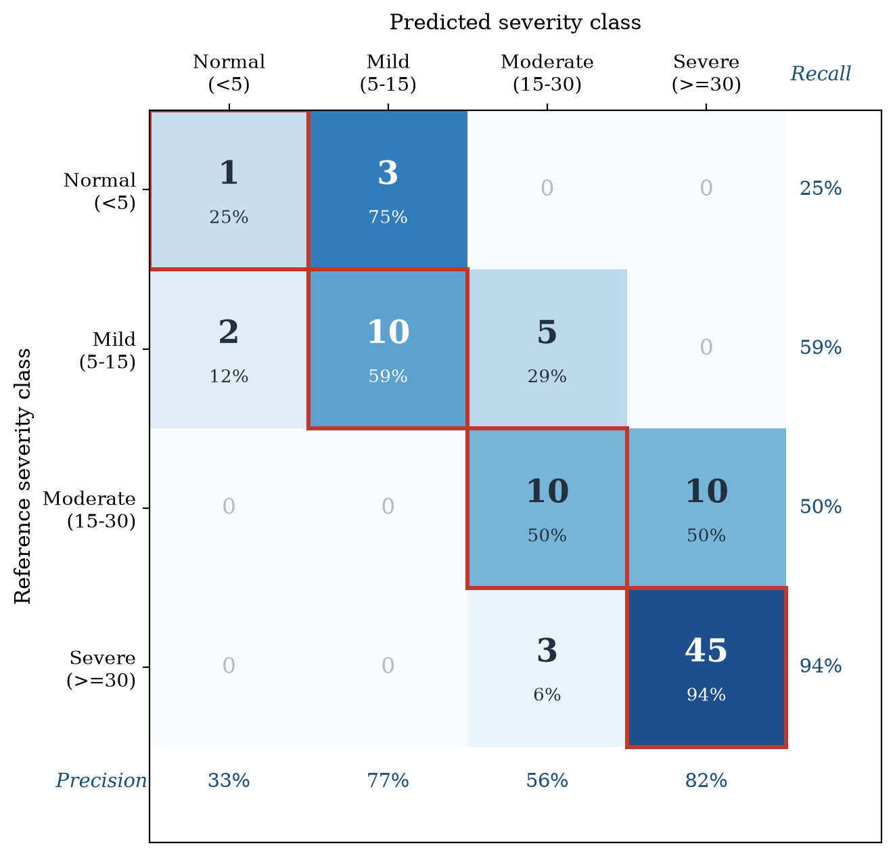

# Patient-Independent Epoch-Level Classification of Sleep-Disordered Breathing in Ischemic Stroke


Code, per-patient results and figures for the paper

> **Patient-Independent Epoch-Level Classification of Sleep-Disordered Breathing in Ischemic Stroke Using Hybrid Deep Temporal Representations**
> Nishant Omhare, Sayani Neogi, Ayush Tripathi
> Indian Institute of Technology Indore · Indian Institute of Technology Jammu

A hybrid deep temporal model labels every 30-second epoch of an overnight polysomnogram (PSG) as *respiratory event* or *no event*. It is trained and tested on the iSLEEPS ischemic-stroke cohort under a strict leave-one-patient-out (LOPO) protocol, so every reported number comes from a patient the model never saw during training, early stopping or threshold selection.

| F1-score | Sensitivity | Specificity | AUROC | eAHI correlation |
|:---:|:---:|:---:|:---:|:---:|
| **0.612** ± 0.186 | **0.705** ± 0.210 | **0.843** ± 0.118 | **0.884** ± 0.066 | **r = 0.913** |

Mean ± SD across 89 held-out patients.

---

## Contents

- [Highlights](#highlights)
- [Method](#method)
- [Results](#results)
- [Repository structure](#repository-structure)
- [Getting started](#getting-started)
- [Reproducing the paper](#reproducing-the-paper)
- [Limitations](#limitations)
- [Citation](#citation)
- [Acknowledgements](#acknowledgements)

---

## Highlights

- **Strictly patient-independent.** 89-fold LOPO. In each fold, 1 patient is held out for testing, 12 are used for validation and 76 for training. The decision threshold is tuned on the validation patients only.
- **Dual-rate encoder.** Respiratory signals are encoded at 32 Hz and slowly varying signals (SpO₂, pulse rate, ECG envelope) at 4 Hz, each with six squeeze-and-excitation residual blocks with dilations 1 to 32.
- **20 minutes of context.** A two-layer BiGRU reads 40 consecutive epochs and emits one prediction per epoch.
- **Hybrid representation.** Learned embeddings are concatenated with 33 handcrafted physiological features that mirror AASM respiratory-event criteria.
- **Auxiliary supervision.** Event-burden and onset/offset heads regularise training; only the event logit is used at test time.
- **Three controlled comparisons.** A 2 × 2 loss ablation (class weighting × focal term), a with/without handcrafted-features ablation, and seven classical ML baselines, all on identical folds.
- **Small model.** 485,692 trainable parameters.

## Method

### Data

The study uses [iSLEEPS](#acknowledgements), a set of overnight PSG recordings from 100 patients with ischemic stroke, collected at NIMHANS, Bengaluru, and manually scored with AASM criteria. Eleven recordings were excluded because a required channel was missing or flat for the whole night, leaving **89 recordings** (85,288 epochs, 24.5% positive).

**The raw data is not distributed in this repository.** It must be obtained from the iSLEEPS authors (see [Acknowledgements](#acknowledgements)).

### Preprocessing

| Stream | Channels | Rate | Shape per epoch |
|---|---|---|---|
| Respiratory | nasal pressure, thermistor flow, PPG, thorax effort, abdomen effort | 32 Hz | 5 × 960 |
| Slow | SpO₂, pulse rate, ECG envelope | 4 Hz | 3 × 120 |
| Handcrafted | 33 features computed from the original-rate signals | per epoch | 33 |

- Recordings are cut into non-overlapping 30-second epochs.
- The ECG envelope (Hilbert magnitude, low-pass filtered below 0.45 Hz) is extracted *before* resampling, so the QRS complex is not aliased.
- **Labels.** An epoch is positive if any part of a scored apnea, hypopnea or RERA falls inside it. No minimum overlap is required, so one event can mark two epochs. The task is therefore epoch classification, not event detection.
- Epochs are grouped into overlapping sequences of 40 (20 minutes). At inference, probabilities for epochs covered by several windows are averaged.

### The 33 handcrafted features

| Group | Count | Features |
|---|:---:|---|
| Flow and effort (nasal pressure, thermistor, thorax, abdomen) | 20 | Per channel: mean and minimum amplitude ratio against a rolling-median baseline, fraction of seconds below 0.7× and 0.5× baseline, longest run below 0.5× baseline |
| SpO₂ | 7 | Minimum, mean, range, drop from the maximum of the preceding 4 min, ≥ 3% desaturation flag, fraction below 90%, slope |
| Pulse rate | 4 | Deviation from baseline, standard deviation, range, largest 1-second increment |
| Paradoxical effort | 2 | Thorax–abdomen envelope correlation and amplitude ratio |

### Architecture



The residual blocks use dilated depthwise-separable convolutions with group normalisation, GELU, squeeze-and-excitation recalibration and dropout.

### Training objective

$$\mathcal{L} = \mathcal{L}_{\text{event}} + 0.3\,\mathcal{L}_{\text{burden}} + 0.2\,\mathcal{L}_{\text{boundary}}$$

$\mathcal{L}_{\text{event}}$ is one of BCE, class-weighted BCE, focal or class-weighted focal loss. The burden head predicts the fraction of positive epochs in the 40-epoch sequence, and the boundary head predicts event onsets and offsets.

| Setting | Value |
|---|---|
| Optimiser | AdamW, learning rate 2e-3, weight decay 3e-4 |
| Schedule | OneCycleLR, mixed precision, gradient clipping at 3.0 |
| Batch size | 16 sequences of 40 epochs |
| Epochs | up to 14, early stopping with patience 5 |
| Sequence stride | 10 epochs (train), 20 epochs (evaluation, 50% overlap) |
| Focal γ / positive-weight cap | 2.0 / 12 |
| Dropout | 0.2 |
| Seed | 42 |

## Results

### Epoch-level classification (LOPO, mean ± SD over 89 patients)

| Experiment | Model | Accuracy | Sensitivity | Specificity | F1-score | AUROC |
|---|---|:---:|:---:|:---:|:---:|:---:|
| **Deep + 33 features** | **BCE** | **0.835 ± 0.086** | 0.705 ± 0.210 | **0.843 ± 0.118** | **0.612 ± 0.186** | **0.884 ± 0.066** |
| | Weighted BCE | 0.833 ± 0.089 | 0.696 ± 0.222 | 0.838 ± 0.125 | 0.604 ± 0.192 | 0.880 ± 0.072 |
| | Focal | 0.834 ± 0.087 | 0.701 ± 0.216 | 0.839 ± 0.120 | 0.610 ± 0.185 | 0.884 ± 0.068 |
| | Weighted focal | 0.834 ± 0.087 | 0.702 ± 0.211 | 0.841 ± 0.123 | 0.612 ± 0.180 | 0.881 ± 0.069 |
| Deep, no handcrafted features | BCE | 0.827 ± 0.095 | 0.710 ± 0.221 | 0.824 ± 0.137 | 0.606 ± 0.185 | 0.880 ± 0.067 |
| | Weighted BCE | 0.818 ± 0.100 | 0.708 ± 0.219 | 0.812 ± 0.148 | 0.598 ± 0.180 | 0.874 ± 0.068 |
| | Focal | 0.825 ± 0.096 | 0.704 ± 0.221 | 0.824 ± 0.141 | 0.603 ± 0.186 | 0.877 ± 0.073 |
| | Weighted focal | 0.822 ± 0.097 | **0.712 ± 0.222** | 0.816 ± 0.145 | 0.600 ± 0.188 | 0.877 ± 0.071 |
| 33 features + classical ML | Logistic regression | 0.729 ± 0.101 | 0.679 ± 0.199 | 0.715 ± 0.143 | 0.487 ± 0.184 | 0.782 ± 0.081 |
| | Random forest | 0.801 ± 0.094 | 0.655 ± 0.206 | 0.803 ± 0.141 | 0.556 ± 0.181 | 0.834 ± 0.075 |
| | HistGradientBoosting | 0.804 ± 0.089 | 0.655 ± 0.202 | 0.810 ± 0.129 | 0.559 ± 0.179 | 0.835 ± 0.073 |
| | XGBoost | 0.803 ± 0.089 | 0.652 ± 0.201 | 0.810 ± 0.129 | 0.555 ± 0.180 | 0.833 ± 0.074 |
| | SVM (RBF) | 0.777 ± 0.100 | 0.649 ± 0.204 | 0.776 ± 0.149 | 0.526 ± 0.183 | 0.803 ± 0.077 |
| | Soft voting | 0.799 ± 0.093 | 0.665 ± 0.202 | 0.798 ± 0.140 | 0.557 ± 0.179 | 0.834 ± 0.074 |
| | Stacked LR | 0.810 ± 0.088 | 0.643 ± 0.202 | 0.821 ± 0.127 | 0.561 ± 0.180 | 0.837 ± 0.074 |

The hybrid model with BCE also reaches precision 0.574 ± 0.200 and PR-AUC 0.675 ± 0.216. The full metric set (MCC, Cohen's κ, balanced accuracy, Brier score, calibration error) is in the CSV files at the repository root.

**What the comparisons show**

1. **Learned representations carry the performance.** The deep model beats the best classical baseline trained on the same 33 features (F1 0.612 vs 0.561, AUROC 0.884 vs 0.837).
2. **Handcrafted features add little.** Removing them changes F1 from 0.612 to 0.606, which is small against the between-patient spread.
3. **The choice of loss does not matter here.** The four losses span F1 0.604 to 0.612 and AUROC 0.880 to 0.884. Paired Wilcoxon signed-rank tests on per-patient metrics found no significant difference.
4. **Between-patient variability is the open problem.** A standard deviation of 0.19 in F1 means performance on an unseen patient can differ widely from the mean.

### Patient-level SDB burden

The epoch-level AHI (eAHI) is the number of positive epochs within sleep divided by total sleep time in hours. Because RERAs are counted, it corresponds to a respiratory disturbance index and not to a clinical AHI.

| Predicted vs reference eAHI | Severity band agreement |
|:---:|:---:|
|  |  |

| Agreement metric | Value |
|---|---|
| Pearson r | 0.913 (95% CI 0.87 to 0.94) |
| Lin's concordance (CCC) | 0.903 |
| ICC(2,1) | 0.904 |
| Mean absolute error | 8.48 events/h |
| Bias (Bland–Altman) | +3.24 events/h, 95% limits −18.5 to +25.0 |
| Severity band accuracy | 74.2% (66 of 89), every patient within one band |
| Cohen's κ / quadratic-weighted κ | 0.563 / 0.838 |

Per-patient values and the remaining figures (Bland–Altman, metrics by severity band, per-patient error) are in [`AHI_calculation_results/`](AHI_calculation_results).

## Repository structure

### Paper pipeline

| Notebook | Purpose |
|---|---|
| [`disordered_breathing_datasetcreator.ipynb`](disordered_breathing_datasetcreator.ipynb) | Reads the raw EDF recordings and event sheets, extracts the eight channels, cuts 30-second windows and writes per-patient arrays with binary labels |
| [`apnea_pipeline_splitwithres.ipynb`](apnea_pipeline_splitwithres.ipynb) | Builds the multi-rate cache (32 Hz and 4 Hz streams, 33 features, sensor masks) and runs the CNN + BiGRU on a single patient-level split |
| [`apnea_loporesult.ipynb`](apnea_loporesult.ipynb) | 89-fold LOPO run of the CNN + BiGRU from the pre-built cache |
| [`apnea_loss_ablation.ipynb`](apnea_loss_ablation.ipynb) | Four-loss ablation under LOPO with handcrafted features (*Deep + 33 features*) |
| [`apnea_loss_ablation_nofeat.ipynb`](apnea_loss_ablation_nofeat.ipynb) | The same ablation with the handcrafted features disconnected |
| [`apnea_33feat_ml_lopo.ipynb`](apnea_33feat_ml_lopo.ipynb) | Classical ML baselines on the 33 features under the same LOPO folds |
| [`ahi_predicted_vs_referencewithres.ipynb`](ahi_predicted_vs_referencewithres.ipynb) | Predicted vs reference eAHI, agreement statistics and severity bands |

[`apnea_loss_ablationwithresults.ipynb`](apnea_loss_ablationwithresults.ipynb) and [`apnea_loss_ablation_nofeatwithresults.ipynb`](apnea_loss_ablation_nofeatwithresults.ipynb) are the executed copies of the two ablation notebooks, with all outputs and figures saved inline.

### Result files

| Path | Contents |
|---|---|
| `metric_comparison_ablation.csv` | Loss ablation, with handcrafted features |
| `metric_comparisonwithoutfeat.csv` | Loss ablation, without handcrafted features |
| `metric_comparison_wide33featuresml.csv` | Classical ML baselines |
| `AHI_calculation_results/tables/` | Per-patient eAHI, agreement statistics, severity confusion matrix |
| `AHI_calculation_results/figures/` | Eight figures as PNG and PDF |

### Earlier experiments

These notebooks record the single-split exploration that preceded the LOPO study. They are not needed to reproduce the paper.

| Notebook | Purpose |
|---|---|
| [`resnet1d_context_radius_weighted_focalwithresult.ipynb`](resnet1d_context_radius_weighted_focalwithresult.ipynb) | 1D ResNet on 200 Hz windows, context radius 0, 1 and 2 |
| [`se_resnet1d_context_radius_weighted_focalwithres.ipynb`](se_resnet1d_context_radius_weighted_focalwithres.ipynb) | SE-ResNet1D, same context-radius comparison |
| `sleep-data-classification-model-deep-learning (3).ipynb` | Early Kaggle prototypes |

## Getting started

### Requirements

Python 3.10 or newer, and a CUDA GPU for the deep-learning notebooks.

```bash
git clone https://github.com/NishantOmhare/Sleep-disordered-breathing-epoch-classification.git
cd Sleep-disordered-breathing-epoch-classification

python -m venv .venv && source .venv/bin/activate
pip install torch torchinfo numpy scipy pandas scikit-learn xgboost matplotlib joblib pyedflib openpyxl jupyter
```

Install the PyTorch build that matches your CUDA version from [pytorch.org](https://pytorch.org/get-started/locally/).

### Paths

The LOPO, ablation and baseline notebooks read two environment variables and fall back to a hard-coded project folder if they are unset:

```bash
export APNEA_CACHE=/path/to/apnea_cache_resampled   # folder of per-patient .npz files
export APNEA_RESULT=/path/to/output_folder
```

The dataset-creation, single-split and eAHI notebooks set their paths in their configuration cell (`PROJECT_DIR`, `DEFAULT_DATA_DIR`, `ANNOT_DIR`, `SUBJECT_XLS`). Edit those before running.

Each cached patient file holds `resp` (epochs × 5 × 960), `slow` (epochs × 3 × 120), `feat` (epochs × 33), `y` (epochs) and the two sensor masks.

## Reproducing the paper

| Step | Notebook | Produces | Approximate cost |
|:---:|---|---|---|
| 1 | `disordered_breathing_datasetcreator.ipynb` | Per-patient 200 Hz windows and labels | CPU |
| 2 | `apnea_pipeline_splitwithres.ipynb` | Multi-rate cache with the 33 features | a few minutes for the cache |
| 3 | `apnea_loporesult.ipynb` | `leave_one_out_output/folds/` | about 4 min per fold on an RTX 4090 |
| 4 | `apnea_loss_ablation.ipynb` | `ablation_results/`, Table I rows 1–4 | about 24 h for 4 losses × 89 folds |
| 5 | `apnea_loss_ablation_nofeat.ipynb` | Table I rows 5–8 | about 24 h |
| 6 | `apnea_33feat_ml_lopo.ipynb` | `33features_ml_results/`, Table I rows 9–15 | 20–40 min on CPU |
| 7 | `ahi_predicted_vs_referencewithres.ipynb` | `AHI_calculation_results/` | seconds |

Practical notes:

- **Runs are resumable.** Every fold is written to disk when it finishes and skipped on re-run.
- **Smoke test first.** Set `MAX_FOLDS = 3` in the configuration cell, check the numbers, then set it back to `None`.
- **One loss per session.** `ARMS_TO_RUN` in the ablation notebooks selects which losses to train.
- **Step 7 needs sleep staging.** It reads the per-patient sleep-profile annotations and `subject_description.xlsx` from the iSLEEPS release to restrict both numerators to sleep.

## Limitations

- **Single centre.** All recordings come from one site and one cohort.
- **eAHI depends on reference sleep staging.** Total sleep time is taken from the manual hypnogram.
- **Epoch-level, not event-level.** There is no event-level comparison against existing detectors, and apnea, hypopnea and RERA are merged into one class.
- **Research code.** This is not a medical device and must not be used for diagnosis.

## Citation

If you use this code or the results, please cite the paper and the dataset.

```bibtex
@inproceedings{omhare2026sdb,
  title     = {Patient-Independent Epoch-Level Classification of Sleep-Disordered Breathing
               in Ischemic Stroke Using Hybrid Deep Temporal Representations},
  author    = {Omhare, Nishant and Neogi, Sayani and Tripathi, Ayush},
  booktitle = {IEEE International Conference on Bioinformatics and Bioengineering (BIBE)},
  year      = {2026}
}

@article{maiti2026isleeps,
  title   = {Polysomnography dataset for sleep analysis in ischemic stroke patients},
  author  = {Maiti, S. and Sharma, S. K. and Mythirayee, S. and Rajendran, S. and Bapi, R. S.},
  journal = {Scientific Data},
  volume  = {13},
  number  = {1},
  pages   = {421},
  year    = {2026}
}
```

## Acknowledgements

This work uses the **iSLEEPS** dataset, recorded at the National Institute of Mental Health and Neuro Sciences (NIMHANS), Bengaluru, India, and described in Maiti et al., *Scientific Data* 13, 421 (2026). We thank the dataset authors for making it available.

## Contact

Open an [issue](https://github.com/NishantOmhare/Sleep-disordered-breathing-epoch-classification/issues) for questions about the code or results.

- Nishant Omhare, Department of Electrical Engineering, IIT Indore
- Sayani Neogi, Department of Electrical Engineering, IIT Jammu
- Ayush Tripathi, Department of Electrical Engineering, IIT Indore
